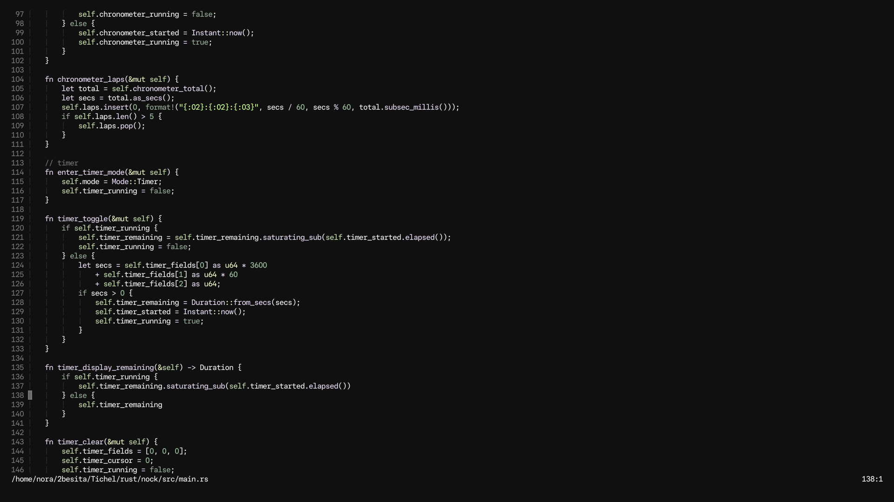
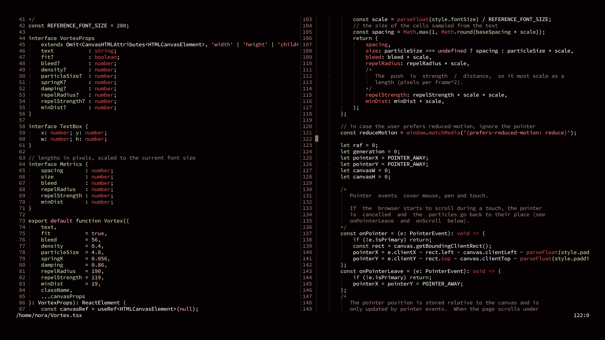
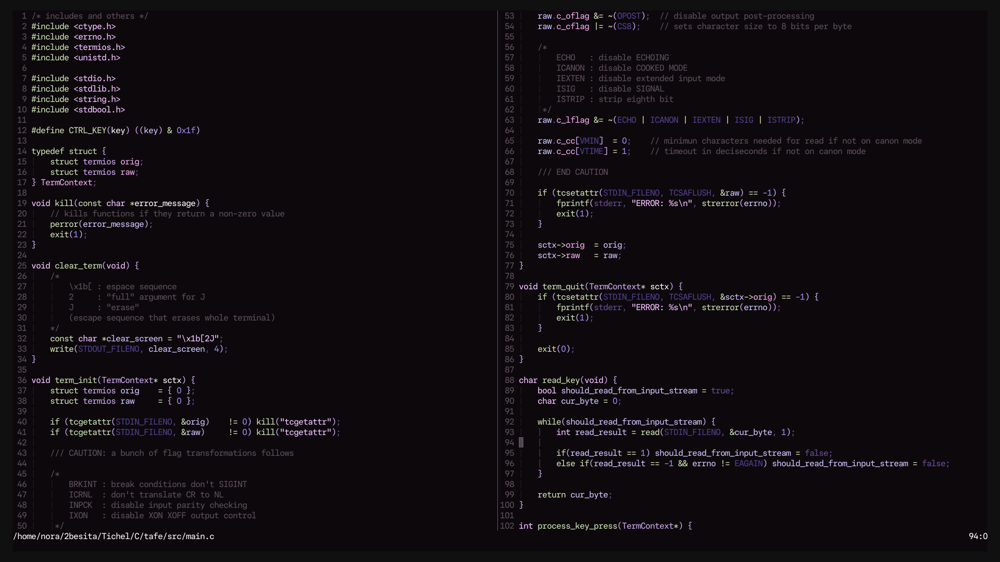

## Echidna.nvim

<p align="center">
Echidna is a theme collection for neovim focused on low saturation and
contrast, aiming to an almost monochromatic vibe, each theme featuring only a
main color with its variations, one secondary color and a rarely seen color for
errors (so you don't think errors are part of the code :D).<br/>

*I don't use plugins, so there's still no plugin implementation and I don't plan
on doing it. Feel free to make a pr*<br/>
*I also don't use treesitter, so the themes may look different than on preview*</br>
</p>

## Previews
<details> 
<sumary> amni </sumary>

</details>
<details> 
<sumary> cocoa </sumary>

</details>
<details> 
<sumary> lycoris </sumary>

</details>
<details> 
<sumary> wisteria </sumary>

</details>

### Installation
lazyvim:
```lua
return {
    "2besita/echidna.nvim",
    lazy = false,
    priority = 1000,
}
```

vim.pack:
```lua
vim.pack.add({
    "https://github.com/2besita/echidna.nvim.git",
})
```

#### Usage
Add this to your configuration:
```lua
vim.cmd.colorscheme("echidna")
```

or `echidna-cocoa`, `echidna-lycoris`, etc.<br/>

You also have a set of configurations you can apply:
```lua
require("echidna").setup({
    variant = "echidna-amni",
    transparent = false,
    italics = {
        comments = false,
        keywords = false,
        functions = false,
        strings = false,
        variables = false,
        bufferline = false,
    },
    overrides = {},
})
```
*These are the default values*

Or run `:colorscheme echidna`

### Ports
You can find a port for `foot terminal` on the "ports" subdirectory.
Also, there's a [port of this theme for Emacs](https://github.com/tichelmorres/echidna-emacs-theme.git) made by [tichelmorres](https://github.com/tichelmorres)
