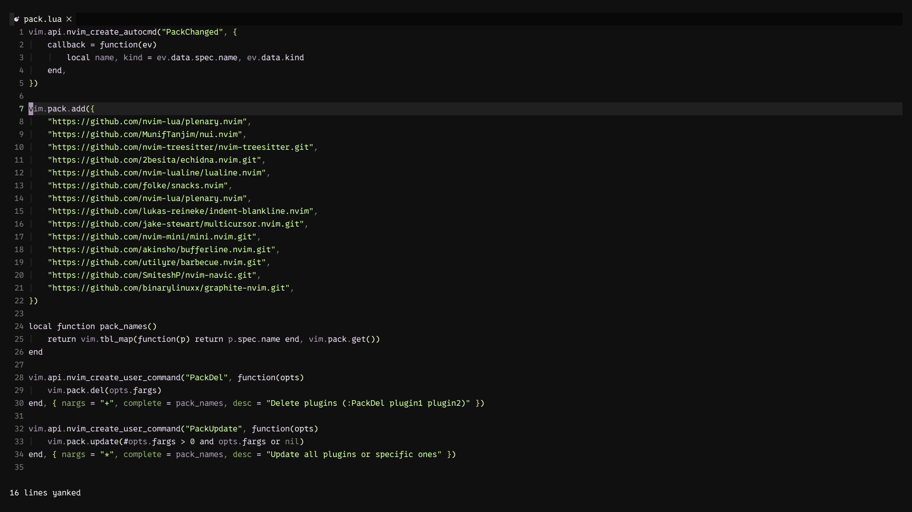
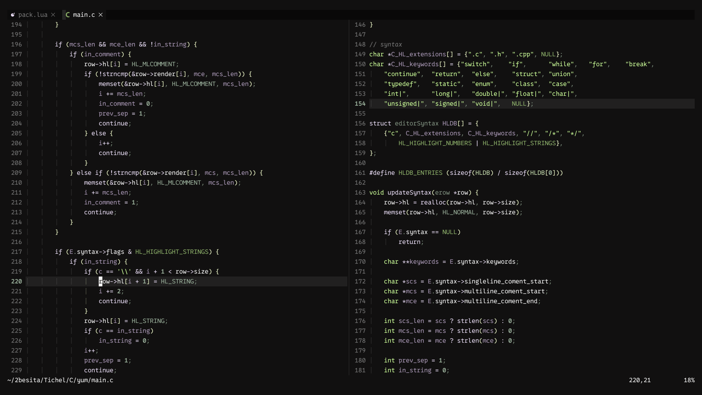
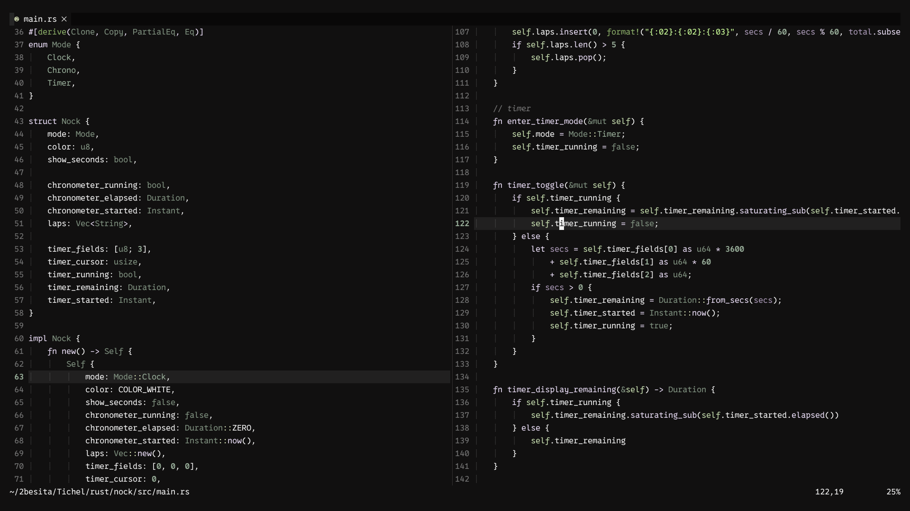

## Echidna.nvim

<p align="center">
Echidna is a theme collection for neovim focused on low saturation and contrast, aiming to an almost monochromatic vibe, each theme featuring only a main color with its variations, one secondary color and a rarely seen color for errors (so you don't think errors are part of the code :D).
</p>

### How to install
lazyvim:
```lua
return {
    "2besita/echidna.nvim",
    lazy = false,
    priority = 1000,
}
```

vim.pack:
```lua
vim.pack.add({
    "https://github.com/2besita/echidna.nvim.git",
})
```

#### Usage
Add this to your configuration:
```lua
vim.cmd.colorscheme("echidna")
```

Or run `:colorscheme echidna`

### Ports
You can find a port for `foot terminal` on the "ports" subdirectory.
Also, there's a [port of this theme for Emacs](https://github.com/tichelmorres/echidna-emacs-theme.git) made by [tichelmorres](https://github.com/tichelmorres)
### Preview



