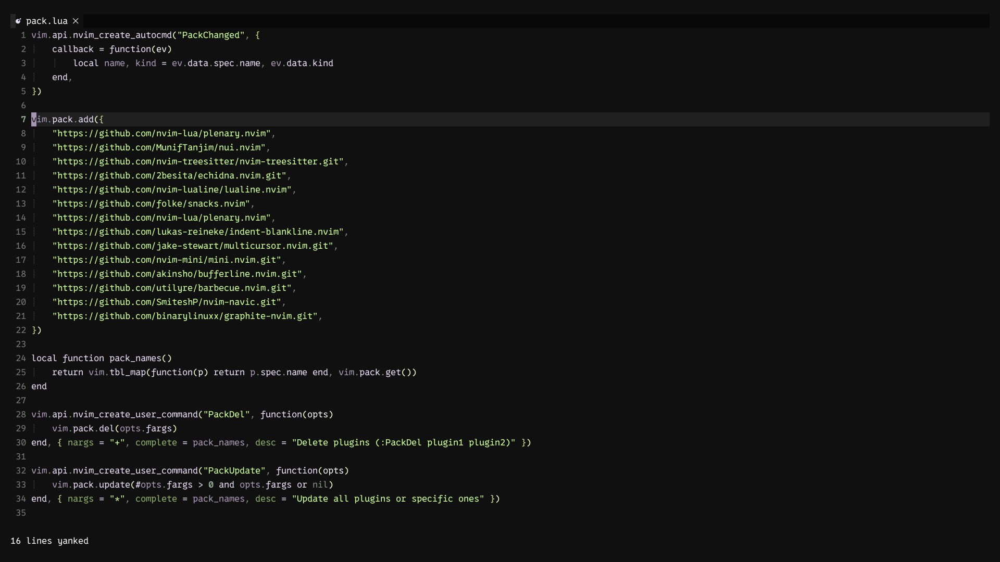
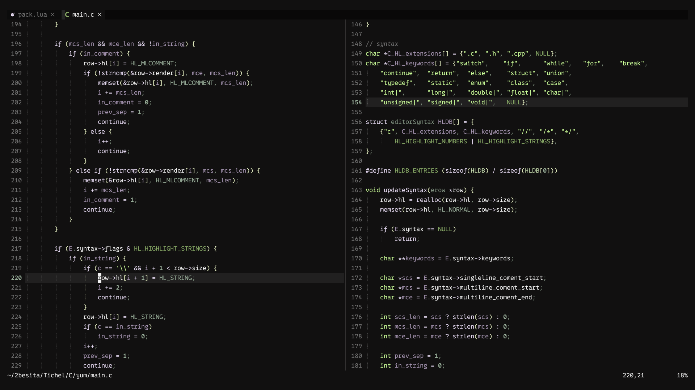
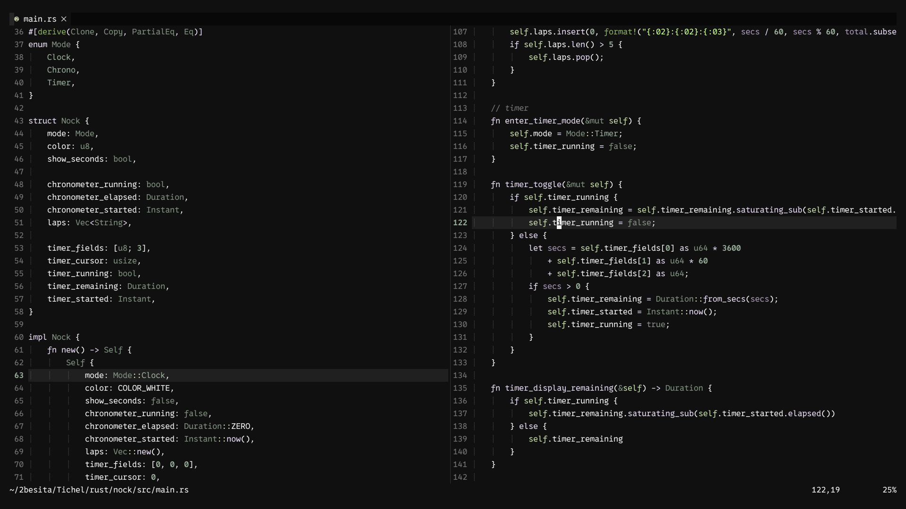

## Echidna.nvim

Echidna is a dark colorscheme for neovim, focused on low saturation and contrast between colors, aiming to cause less
eyesore while viewing and writing code (at least for me) and making the colors consistent between monitors of varied
qualities and display technologies.

### How to install
lazyvim:
```lua
return {
    "2besita/echidna.nvim",
    lazy = false,
    priority = 1000,
}
```

vim.pack:
```lua
vim.pack.add({
    "https://github.com/2besita/echidna.nvim.git",
})
```

#### Usage
Add this to your configuration:
```lua
vim.cmd.colorscheme("echidna")
```

Or run `:colorscheme echidna`

### Ports
You can find a port for `foot terminal` on the "ports" subdirectory.
Also, there's a [port of this theme for Emacs](https://github.com/tichelmorres/echidna-emacs-theme.git) made my [tichelmorres](https://github.com/tichelmorres)
### Preview



